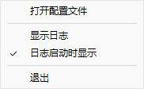
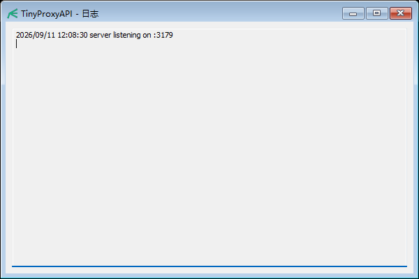

# TinyProxyAPI

[](./LICENSE)
[](https://goreportcard.com/report/github.com/gjj2828/TinyProxyAPI)
[](https://github.com/gjj2828/TinyProxyAPI/actions/workflows/ci.yml)
[](https://github.com/gjj2828/TinyProxyAPI/releases)

[English](./README_EN.md) | 极轻量的 API 路由代理服务，根据请求中的模型名将请求透传到对应的平台。

## 背景

市面上的 API 中转站定价不一：有些提供 `luna` 转发但倍率较高，有些只有 `terra`/`sol`/`astra` 等转发且倍率较低。通过 CPA 代理的请求经常会被中转站识别拦截导致失败。

TinyProxyAPI 的核心优势在于**透传**——除了必须替换的 Header 中的 Host 和 Authorization 之外，Header 中的其他字段和 Body 中的所有内容都原封不动转发，转发行为接近直接请求，因此不会被中转站的风控机制识别。可以将不同平台的中转站聚合起来，通过配置文件按模型名自动路由到合适的中转站。切换中转站只需改 `config.toml`，Codex 客户端侧全程无感知。

## 特性

- **透传** - 使用 `httputil.ReverseProxy`，Body 原封不动转发，仅替换路由必需的 Header（Host 和 Authorization），不进行任何内容检查或修改
- **多协议** - 支持 `responses`（`/v1/responses`）、`openai`（`/v1/chat/completions`）、`anthropic`（`/v1/messages`）三种协议端点，请求按原格式透传到上游同名端点
- **灵活路由** - 模型名全量匹配，通过 TOML 配置；可按协议覆盖，让同一模型在不同协议下走不同平台
- **平台抽象** - 同一平台的多个模型共享 base_url 和 api_key
- **热重载** - 改完 `config.toml` 保存即生效（基于 fsnotify 跨平台监听）；Linux/Mac 也可发 SIGHUP 触发
- **自动初始化** - 未检测到配置文件时自动生成默认 `config.toml`，并调起关联编辑器引导配置
- **系统托盘** - Windows 运行时隐藏控制台窗口，通过托盘图标管理程序（显示/隐藏日志窗口、打开配置文件、退出）
- **日志窗口** - 可查看程序运行日志，支持启动时自动显示

> **已支持三种协议端点**：`/v1/responses`（OpenAI Responses API，Codex 使用）、`/v1/chat/completions`（OpenAI Chat Completions API）、`/v1/messages`（Anthropic Messages API）。请求按原格式透传到上游同名端点，代理仅替换 Host 与鉴权头（Anthropic 自动使用 `x-api-key`）。

## 快速开始

### 配置文件

```toml
# config.toml
allowed_keys = ["your-client-key-here"]

[server]
addr = ":3178"

[default]
platform = "openai"

[platforms]
"openai" = { base_url = "https://api.openai.com", api_key = "sk-your-key" }
"anthropic" = { base_url = "https://api.anthropic.com", api_key = "sk-ant-your-key" }

[models]
# 通用映射：model -> platform，未按协议特别指定时使用
"gpt-4o" = "openai"
"gpt-4o-mini" = "openai"
"claude-sonnet-4-20250514" = "anthropic"

# 可选：按协议覆盖，优先级高于上面的 [models]
# 协议名由客户端端点决定：responses / openai / anthropic
# [models.responses]
# "gpt-4o" = "anthropic"
```

> **协议说明**：客户端请求的端点决定协议，并按原格式透传到上游同名端点——
> `POST /v1/responses` → `responses`、`POST /v1/chat/completions` → `openai`、`POST /v1/messages` → `anthropic`。
> 路由按「(协议, 模型) → 平台」匹配：先查 `[models.<协议>]`，再查 `[models]`，最后回退 `[default].platform`。
> 因此同名模型在不同协议下可以指向不同平台。向 Anthropic 上游转发时会自动使用 `x-api-key`（并在缺失时补默认 `anthropic-version`），不会泄露客户端凭证。

> ⚠️ **TOML 坑**：`allowed_keys` 是顶层 key，必须放在**所有 `[table]` 之前**。
> 如果写在 `[default]` 之后，它会被归入 `[default]` 表，但由于 `DefaultConfig` 结构体没有 `AllowedKeys` 字段，这个值会被**静默忽略**，导致所有客户端 key 都被白名单拒绝、代理返回 401 `invalid api key`。

### 运行

```powershell
# Windows 构建（隐藏控制台窗口）
.\build.ps1

# 运行
.\TinyProxyAPI.exe -config config.toml
```

> 或手动构建：`go build -ldflags="-H windowsgui" -o TinyProxyAPI.exe .`
> Windows 上 `go build -o name .` 不会自动补 `.exe` 后缀，必须显式指定。

### 请求示例

**模型列表：**
```bash
curl http://localhost:3178/v1/models
```

**Responses（OpenAI Responses API）：**
```bash
curl -X POST http://localhost:3178/v1/responses \
  -H "Content-Type: application/json" \
  -d '{"model": "gpt-4o", "input": "Hello"}'
```

**Chat Completions（OpenAI Chat Completions API）：**
```bash
curl -X POST http://localhost:3178/v1/chat/completions \
  -H "Content-Type: application/json" \
  -H "Authorization: Bearer your-client-key" \
  -d '{"model": "gpt-4o", "messages": [{"role": "user", "content": "Hello"}]}'
```

**Messages（Anthropic Messages API）：**
```bash
curl -X POST http://localhost:3178/v1/messages \
  -H "Content-Type: application/json" \
  -H "x-api-key: your-client-key" \
  -d '{"model": "claude-sonnet-4-20250514", "max_tokens": 1024, "messages": [{"role": "user", "content": "Hello"}]}'
```

## 配置热重载

**保存 `config.toml` 后自动生效**——程序通过 fsnotify 监听配置文件，跨平台都支持（Windows / macOS / Linux）。

如果想手动触发（仅 Linux/Mac）：

```bash
kill -HUP $(pidof TinyProxyAPI)
```

## 系统托盘（Windows）

程序启动后会在系统托盘显示图标，右键菜单提供以下功能：

| 菜单项 | 功能 |
|--------|------|
| 显示日志 | 勾选后显示日志查看窗口 |
| 日志启动时显示 | 勾选后下次启动自动显示日志窗口 |
| 打开配置文件 | 使用系统关联程序（或记事本兜底）打开配置文件 |
| 退出 | 关闭程序 |

- 单击托盘图标可切换日志窗口显示状态（替代了旧版的双击）
- 点击最小化按钮会隐藏窗口到托盘

### 界面截图

右键单击系统托盘图标，可以显示日志、设置是否在启动时自动显示日志，或退出程序：



日志窗口会显示服务器启动、配置热重载以及运行时错误等信息：



### 界面状态

「日志启动时显示」的设置**不由 `config.toml` 管理**，而是由托盘菜单控制，保存在用户目录的 `~/.tinyproxyapi/state.json` 中，默认值为启动时显示。

`config.toml` 始终只读——程序不会写回该文件，你的注释和格式不会被改动。

### 重新生成图标

托盘图标由 `tools/genicon` 生成并嵌入 `rsrc.syso`，单文件分发即可，无需准备外部图标文件：

```bash
go run ./tools/genicon
rsrc -manifest TinyProxyAPI.exe.manifest -ico icon.ico -o rsrc.syso
```

生成产物 `icon.ico` 与 `rsrc.syso` 需要一并提交。

> **注意**：`rsrc` 分配的 GROUP_ICON 资源 ID 取决于 ICO 内的图像条目数，不是固定值。改动 `tools/genicon/` 后如果条目数变化，必须更新 `tray/tray.go` 里的 `iconResourceID` 常量——构建 exe 后用 `go run ./tools/resid TinyProxyAPI.exe` 读出实际 ID 再核对。

## 项目结构

```
TinyProxyAPI/
├── main.go            # 程序入口（托盘编排、状态管理）
├── config/
│   ├── loader.go      # 配置加载（只读，不写回 config.toml）
│   └── template.go    # 默认配置模板与初始化创建
├── state/
│   └── state.go       # 界面状态读写（state.json）
├── handler/
│   └── proxy.go       # 请求处理
├── matcher/
│   └── matcher.go     # 路由匹配
├── signal/
│   ├── sighup.go      # SIGHUP 信号处理（Linux/Mac）
│   └── watcher.go     # fsnotify 文件监听（跨平台）
├── tray/
│   ├── tray.go        # 系统托盘管理
│   └── logwindow.go   # 日志窗口
├── tools/
│   ├── genicon/       # 生成 icon.ico
│   └── resid/         # 从 exe 读出图标资源 ID
├── config.toml        # 配置文件（含密钥，不入库）
├── config.toml.example  # 配置模板
├── icon.ico           # 图标资源，已嵌入 rsrc.syso
├── rsrc.syso          # 内嵌资源（图标 + manifest），构建时自动链接
├── build.ps1          # Windows 构建脚本
└── TinyProxyAPI.exe.manifest # 公共控件 manifest
```

## 依赖

- Go 1.21+
- github.com/pelletier/go-toml/v2
- github.com/fsnotify/fsnotify
- github.com/lxn/walk（系统托盘）

## 开源协议

本项目基于 [MIT License](./LICENSE) 开源。
